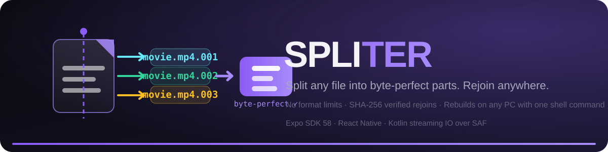
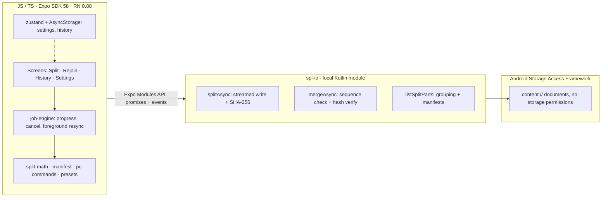
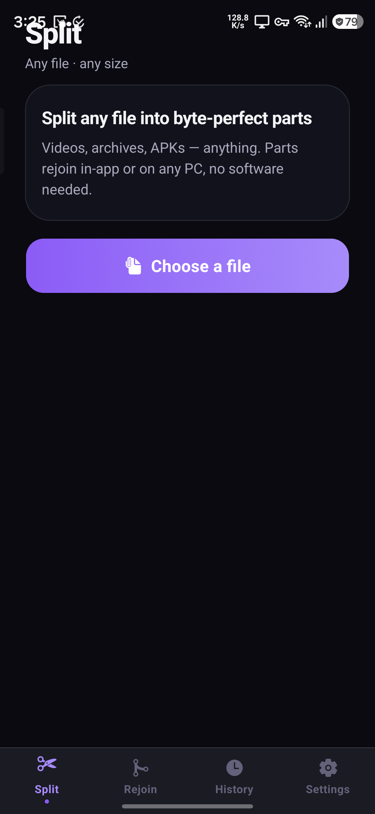
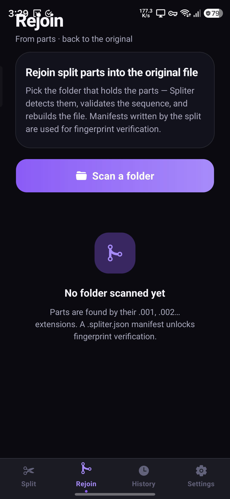
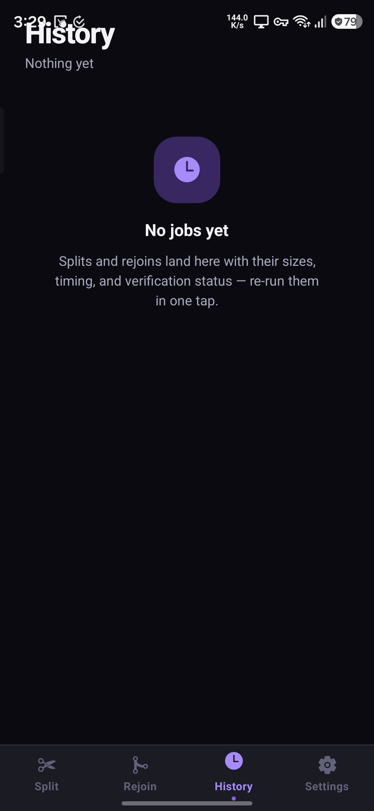
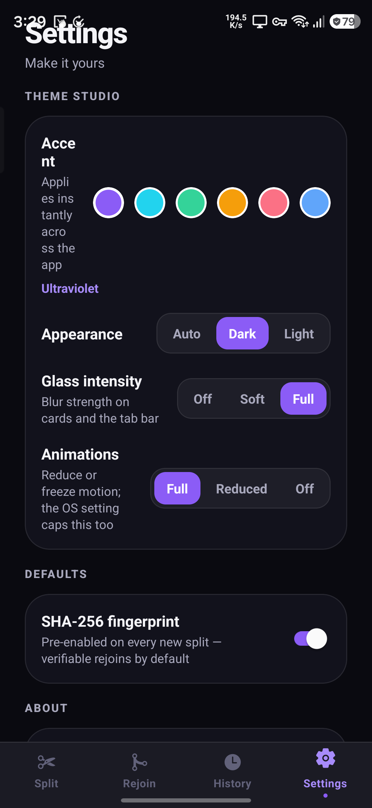

<div align="center">



**Split any file into byte-perfect parts. Rejoin them anywhere — on your phone, or on any PC with one shell command.**

[](https://developer.android.com)
[](https://expo.dev)
[](https://avithegod2010.github.io/Spliter/)
[](#verify-it-yourself)
[](#verify-it-yourself)
[](LICENSE)

**🌐 [Open the animated website](https://avithegod2010.github.io/Spliter/)**

</div>

---

## Why

Every file-sharing app has a ceiling — and it's always the wrong one. A 6 GB video won't move over WhatsApp. An APK won't email. An ISO won't fit the FAT32 stick you're handing someone. Cloud drives want accounts, uploads, and patience.

**Spliter doesn't care what the file is.** It's a byte-level splitter: it cuts *any* file — video, archive, APK, disk image, whatever — into parts sized for where it needs to go, and rejoins them with zero loss. The parts rejoin **inside the app** or on **any Windows / macOS / Linux machine** with a single built-in shell command. No receiver-side software needed.

## Highlights

| | |
|---|---|
| ✂️ **Universal byte-split** | Any file, any size — split by **part size** (MB/GB keypad + smart presets) or by **number of parts** |
| 📲 **Smart presets** | One tap: Telegram · WhatsApp · Discord · Gmail · FAT32 USB · Email-safe |
| 🔀 **In-app rejoin** | Point at a folder; parts are auto-detected by extension, sequence-validated, then rebuilt |
| 🖥️ **PC Rejoin Kit** | Generates the exact `copy /b` and `cat` command — the receiver needs *nothing* but a terminal |
| 🛡️ **Integrity Vault** | Optional SHA-256 fingerprint of the source; rebuilt files are hash-verified and badged — a mismatch deletes the output rather than saving a corrupted file |
| ⚡ **Native streaming engine** | Local Kotlin module, 8 MB streaming buffers over Android SAF — no full-file reads, handles 10 GB+ sources, background-proof |
| 📜 **Job history** | Every split and rejoin persisted with size, timing and verification status — one-tap re-run, shareable rejoin kit |
| 🎨 **Theme Studio** | 6 accent palettes, dark/light/auto, glass intensity, animation level (full/reduced/off) — applied instantly app-wide |

## The PC Rejoin Kit — the part people actually need

This is the moment the app exists for: you've split a file, sent the parts (email, chat, sneakernet), and the person on the other end has no app. Spliter hands you the command — you share it with the file:

```bat
:: Windows
copy /b "movie.mp4.001" + "movie.mp4.002" + "movie.mp4.003" "movie.mp4"
```

```bash
# macOS / Linux
cat "movie.mp4.001" "movie.mp4.002" "movie.mp4.003" > "movie.mp4"
```

`cat` and `copy /b` have shipped with every desktop OS for 30 years. **The parts rejoin byte-for-byte** — and if you split with a fingerprint enabled, the hash inside `movie.mp4.spliter.json` proves it.

## How it works

```
 pick a file → choose part size (or preset) → native streaming split
                                                    │
        ┌───────────────────────────────────────────┘
        ▼
 movie.mp4.001 · movie.mp4.002 · movie.mp4.003 · movie.mp4.spliter.json
        │                                    (SHA-256, sizes, part count)
        ▼
 send parts any way you like ──► rejoin in Spliter, or on any PC
```

<details>
<summary><strong>Architecture</strong></summary>



</details>

<details>
<summary><strong>Why a local native module?</strong></summary>

Expo's JS file APIs can't stream byte ranges through Android's Storage Access Framework on SDK 58 — and Spliter refuses shortcuts that load whole files into memory. The `spl-io` module streams in fixed 8 MB buffers, computes SHA-256 *while* copying, checks a cancel flag between every chunk, and cleans up partial parts on failure. That's what makes 10 GB sources, live progress rings, and background-proof splits possible — and why the app needs a development-client build rather than Expo Go.
</details>

## Screenshots

<div align="center">
<table>
  <tr>
    <td align="center" width="25%"><br/><sub><b>Split</b> — pick any file</sub></td>
    <td align="center" width="25%"><br/><sub><b>Rejoin</b> — parts rebuilt</sub></td>
    <td align="center" width="25%"><br/><sub><b>History</b> — every job</sub></td>
    <td align="center" width="25%"><br/><sub><b>Theme Studio</b> — make it yours</sub></td>
  </tr>
</table>
</div>

## Verify it yourself

Quality gates are part of the repo, not an afterthought:

| Gate | Status |
|---|---|
| Unit tests (split math, manifests, presets, commands, formatting) | ✅ 33/33 |
| TypeScript `--noEmit` (strict) | ✅ 0 errors |
| ESLint (expo config, React Compiler rules) | ✅ 0 problems |
| Native module compile (`:spl-io:assembleDebug`) | ✅ BUILD SUCCESSFUL |

## Build it

```bash
git clone https://github.com/Avithegod2010/Spliter.git
cd Spliter
npm install
npx expo prebuild -p android     # generates the native project
```

Run the JS bundle with a dev client on a device, or cut a standalone APK:

```bash
eas build -p android --profile dev-client    # development client APK
eas build -p android --profile production    # standalone APK
```

> **Note:** the Kotlin engine lives in `modules/spl-io/` and links automatically. Expo Go cannot run it — use a dev-client or production build.

## Status

- ✅ v1 complete — all core flows and the approved feature batch shipped
- ✅ Production APK builds via EAS (`eas build -p android --profile production`)
- 🔜 Play Store listing

## License

[MIT](LICENSE) — © Avithegod2010
